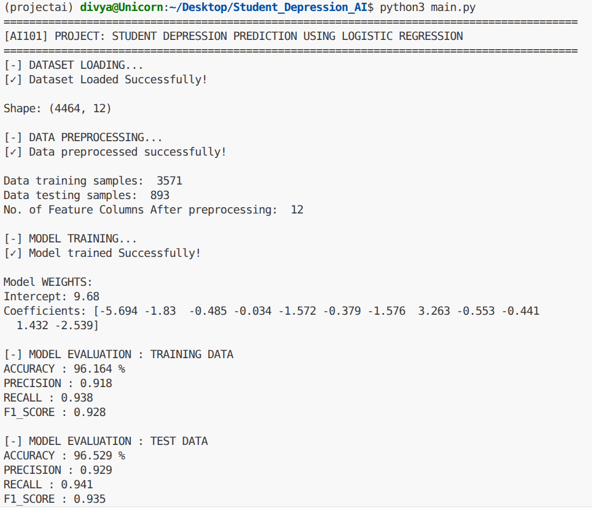

# Student Depression Predictor

Predicts whether the student has depression or not by lifestyle data collected and analyzed (pandas, matplotlib, scikit-learn)

<div style="display: flex; align-items: center; gap: 10px; flex-wrap: nowrap; overflow-x: auto;"> <span style="padding: 1px 4px; background-color: #e0f2fe; color: #0369a1; border: 1px solid #bae6fd; border-radius: 50px; font-size: 13px; font-weight: 500; white-space: nowrap;">AI Project</span> <span style="padding: 1px 4px; background-color: #e0f2fe; color: #0369a1; border: 1px solid #bae6fd; border-radius: 50px; font-size: 13px; font-weight: 500; white-space: nowrap;">Group 60</span></div>

## Team and Roles
|Member| Entry No. | Role|
|---|---|---|
|Divya Goyal| 2026EEB1348 | Executive Lead |
|Agrani Soni| 2026MCB1506 | PPT Lead |
|Aaditya Sharma| 2026EEB1310 | Documentation Lead |
|Nenavath Yashwanth| 2026AIB1063 | Video Lead |

## Project Structure
```bash
├── data_exploration.ipynb
├── data_preprocessing.py
├── main.py
├── outputs
│   ├── Age-distribution.png
│   ├── CGPA-count.png
│   ├── Column-pieCharts.png
│   ├── Depression-count.png
│   ├── FriendCircleVSCGPA.png
│   └── genderVsDepressoin.png
├── README.md
├── requirements.txt
├── AI101_MiniProject_PPT.pdf
├── Project_video.mp4
└── Student_Depression_Dataset.csv
```

## Setup
Tested on Python 3.14
```bash
git clone https://github.com/Divya-iitrpr/Student-Depression-Predictor.git
cd Student-Depression-Predictor
python -m venv venv
source venv/bin/activate  # windows: venv\Scripts\activate
pip install -r requirements.txt
```

## How to Run

#### Data Exploration
- Open Jupyter notebook [data_exploration.ipynb](data_exploration.ipynb) to view complete Data Analysis
- Pre-computed graphs are also available in outputs/.

#### Running the Model
- Run `python main.py`
- This script preprocesses data, trains model and prints statistics/results on both train and test sets.
- The script also exports Confusion matrix and ROC curve for test set in outputs/.
- Expected RunTime: Under 15 seconds

## Expected output


## Links
Slides: [Slides](AI101_MiniProject_PPT.pdf)
Video: [Video](https://drive.google.com/file/d/1svetInsp7IfS6GSD3l8OgmInt5plnuTn/view?usp=sharing)

## AI Use Disclosure
- Code Assistance: Used AI for error debugging and exploring model configurations.
- Presentation & Docs: Assisted in structuring slide layouts and refining
technical documentation.
